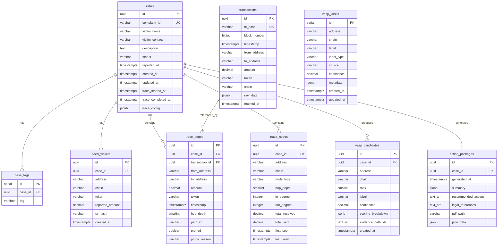
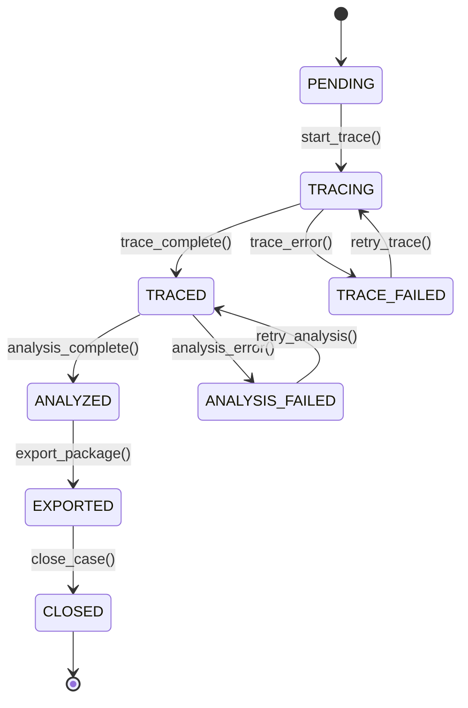

# ANVESHAK — PostgreSQL Data Model Specification

| Field | Value |
|---|---|
| **Version** | 1.0.0 |
| **Status** | DRAFT |
| **Last Updated** | 2026-11-24 |
| **Database** | PostgreSQL 15+ |
| **Migrations** | Alembic (SQLAlchemy) |
| **Schema** | `public` |

---

## 1. Overview

This document defines the complete relational schema for the ANVESHAK complaint-to-action crypto investigation platform. All tables, columns, types, constraints, indexes, relationships, and seed data are specified with enough precision for machine-driven code generation.

### 1.1 Conventions

| Convention | Rule |
|---|---|
| **Primary keys** | `id UUID DEFAULT gen_random_uuid()` unless otherwise stated (serials for junction/label tables) |
| **Timestamps** | All `TIMESTAMPTZ`, always stored in UTC |
| **Monetary amounts** | `DECIMAL(28,8)` — supports up to 10^20 base units with 8 decimal places (sufficient for TRX, USDT, BTC) |
| **Addresses** | `VARCHAR(100)` — TRON base58 addresses are 34 chars; headroom for ETH (42) and future chains |
| **Soft deletes** | Not used; rows are hard-deleted or archived via status transitions |
| **Updated-at trigger** | A shared `set_updated_at()` trigger function auto-sets `updated_at = NOW()` on every `UPDATE` |
| **Naming** | `snake_case` for all identifiers; table names are plural nouns |

### 1.2 Extensions Required

```sql
CREATE EXTENSION IF NOT EXISTS "pgcrypto";   -- gen_random_uuid()
CREATE EXTENSION IF NOT EXISTS "pg_trgm";    -- optional: trigram index for label search
```

---

## 2. Shared Trigger Function

```sql
CREATE OR REPLACE FUNCTION set_updated_at()
RETURNS TRIGGER AS $$
BEGIN
    NEW.updated_at = NOW();
    RETURN NEW;
END;
$$ LANGUAGE plpgsql;
```

Applied to every table that has an `updated_at` column via:

```sql
CREATE TRIGGER trg_<table>_updated_at
    BEFORE UPDATE ON <table>
    FOR EACH ROW
    EXECUTE FUNCTION set_updated_at();
```

---

## 3. Table Definitions

---

### 3.1 `cases`

The root entity. Each row represents one victim complaint / investigation.

| # | Column | Type | Nullable | Default | Constraints / Notes |
|---|--------|------|----------|---------|---------------------|
| 1 | `id` | `UUID` | NO | `gen_random_uuid()` | `PRIMARY KEY` |
| 2 | `complaint_id` | `VARCHAR(50)` | YES | — | `UNIQUE` — National Cyber Crime Reporting Portal (NCRP) reference, e.g. `"NCRP-2026-MH-004821"` |
| 3 | `victim_name` | `VARCHAR(255)` | NO | — | Full name of complainant |
| 4 | `victim_contact` | `VARCHAR(255)` | YES | — | Phone or email; encrypted at application layer |
| 5 | `description` | `TEXT` | NO | — | Free-text complaint narrative |
| 6 | `status` | `VARCHAR(20)` | NO | `'PENDING'` | `CHECK (status IN ('PENDING','TRACING','TRACED','ANALYZED','EXPORTED','CLOSED','TRACE_FAILED','ANALYSIS_FAILED'))` |
| 7 | `reported_at` | `TIMESTAMPTZ` | NO | — | When the victim says the fraud occurred |
| 8 | `created_at` | `TIMESTAMPTZ` | NO | `NOW()` | Row creation time |
| 9 | `updated_at` | `TIMESTAMPTZ` | NO | `NOW()` | Auto-bumped by trigger |
| 10 | `trace_started_at` | `TIMESTAMPTZ` | YES | — | Set when status → `TRACING` |
| 11 | `trace_completed_at` | `TIMESTAMPTZ` | YES | — | Set when status → `TRACED` or `TRACE_FAILED` |
| 12 | `trace_config` | `JSONB` | YES | — | Operator-tunable trace parameters (see §3.1.1) |

**Indexes:**

| Index Name | Columns | Type | Notes |
|---|---|---|---|
| `ix_cases_status` | `status` | B-tree | Filter by pipeline stage |
| `ix_cases_created_at` | `created_at DESC` | B-tree | Dashboard ordering |

**Trigger:** `trg_cases_updated_at` → `set_updated_at()`

#### 3.1.1 `trace_config` JSONB Schema

When present, `trace_config` MUST conform to `API_CONTRACT.md` §2.5:

```jsonc
{
  "hop_limit": 3,               // int, 1–5, default 3
  "time_window_before_days": 30,// int, 1–365, default 30
  "time_window_after_days": 7,  // int, 0–90, default 7
  "degree_cap": 100,            // int, 10–1000, default 100
  "amount_threshold_pct": 0.01  // float, 0.0–1.0, default 0.01
}
```

**DDL:**

```sql
CREATE TABLE cases (
    id              UUID PRIMARY KEY DEFAULT gen_random_uuid(),
    complaint_id    VARCHAR(50) UNIQUE,
    victim_name     VARCHAR(255) NOT NULL,
    victim_contact  VARCHAR(255),
    description     TEXT NOT NULL,
    status          VARCHAR(20) NOT NULL DEFAULT 'PENDING'
                        CHECK (status IN (
                            'PENDING','TRACING','TRACED','ANALYZED',
                            'EXPORTED','CLOSED','TRACE_FAILED','ANALYSIS_FAILED'
                        )),
    reported_at         TIMESTAMPTZ NOT NULL,
    created_at          TIMESTAMPTZ NOT NULL DEFAULT NOW(),
    updated_at          TIMESTAMPTZ NOT NULL DEFAULT NOW(),
    trace_started_at    TIMESTAMPTZ,
    trace_completed_at  TIMESTAMPTZ,
    trace_config        JSONB
);

CREATE INDEX ix_cases_status     ON cases (status);
CREATE INDEX ix_cases_created_at ON cases (created_at DESC);

CREATE TRIGGER trg_cases_updated_at
    BEFORE UPDATE ON cases
    FOR EACH ROW EXECUTE FUNCTION set_updated_at();
```

---

### 3.2 `case_tags`

Freeform tags for case categorisation (e.g. `"pig_butchering"`, `"romance_scam"`, `"investment_fraud"`).

| # | Column | Type | Nullable | Default | Constraints / Notes |
|---|--------|------|----------|---------|---------------------|
| 1 | `id` | `SERIAL` | NO | auto-increment | `PRIMARY KEY` |
| 2 | `case_id` | `UUID` | NO | — | `REFERENCES cases(id) ON DELETE CASCADE` |
| 3 | `tag` | `VARCHAR(50)` | NO | — | Lowercase, alphanumeric + hyphens + underscores (`^[a-z0-9_-]+$`) |

**Constraints:**

| Name | Type | Columns |
|---|---|---|
| `uq_case_tags_case_tag` | UNIQUE | `(case_id, tag)` |

**Indexes:**

| Index Name | Columns | Type |
|---|---|---|
| `ix_case_tags_case_id` | `case_id` | B-tree |

**DDL:**

```sql
CREATE TABLE case_tags (
    id       SERIAL PRIMARY KEY,
    case_id  UUID NOT NULL REFERENCES cases(id) ON DELETE CASCADE,
    tag      VARCHAR(50) NOT NULL,
    UNIQUE (case_id, tag)
);

CREATE INDEX ix_case_tags_case_id ON case_tags (case_id);
```

---

### 3.3 `seed_wallets`

One or more wallet addresses reported by the victim as the destination of funds.

| # | Column | Type | Nullable | Default | Constraints / Notes |
|---|--------|------|----------|---------|---------------------|
| 1 | `id` | `UUID` | NO | `gen_random_uuid()` | `PRIMARY KEY` |
| 2 | `case_id` | `UUID` | NO | — | `REFERENCES cases(id) ON DELETE CASCADE` |
| 3 | `address` | `VARCHAR(100)` | NO | — | Blockchain address (e.g. `"TLa2f6VPqDgRE67v1736s7bJ8Ray5wYjU7"`) |
| 4 | `chain` | `VARCHAR(10)` | NO | `'TRON'` | `CHECK (chain IN ('TRON','ETH','BTC'))` |
| 5 | `token` | `VARCHAR(20)` | NO | `'USDT'` | Token symbol, e.g. `"USDT"`, `"TRX"`, `"USDC"` |
| 6 | `reported_amount` | `DECIMAL(28,8)` | YES | — | Amount the victim claims to have sent |
| 7 | `tx_hash` | `VARCHAR(100)` | YES | — | Transaction hash of victim's initial transfer, if known |
| 8 | `created_at` | `TIMESTAMPTZ` | NO | `NOW()` | Row creation time |

**Indexes:**

| Index Name | Columns | Type |
|---|---|---|
| `ix_seed_wallets_case_id` | `case_id` | B-tree |
| `ix_seed_wallets_address` | `address` | B-tree |

**DDL:**

```sql
CREATE TABLE seed_wallets (
    id               UUID PRIMARY KEY DEFAULT gen_random_uuid(),
    case_id          UUID NOT NULL REFERENCES cases(id) ON DELETE CASCADE,
    address          VARCHAR(100) NOT NULL,
    chain            VARCHAR(10) NOT NULL DEFAULT 'TRON'
                         CHECK (chain IN ('TRON','ETH','BTC')),
    token            VARCHAR(20) NOT NULL DEFAULT 'USDT',
    reported_amount  DECIMAL(28,8),
    tx_hash          VARCHAR(100),
    created_at       TIMESTAMPTZ NOT NULL DEFAULT NOW()
);

CREATE INDEX ix_seed_wallets_case_id ON seed_wallets (case_id);
CREATE INDEX ix_seed_wallets_address ON seed_wallets (address);
```

---

### 3.4 `transactions`

Canonical store for every blockchain transaction fetched from TronGrid (or other chain APIs). De-duplicated across cases via the `(tx_hash, chain)` unique constraint.

| # | Column | Type | Nullable | Default | Constraints / Notes |
|---|--------|------|----------|---------|---------------------|
| 1 | `id` | `UUID` | NO | `gen_random_uuid()` | `PRIMARY KEY` |
| 2 | `tx_hash` | `VARCHAR(100)` | NO | — | On-chain transaction hash |
| 3 | `block_number` | `BIGINT` | NO | — | Block height |
| 4 | `timestamp` | `TIMESTAMPTZ` | NO | — | Block timestamp (UTC) |
| 5 | `from_address` | `VARCHAR(100)` | NO | — | Sender address |
| 6 | `to_address` | `VARCHAR(100)` | NO | — | Recipient address |
| 7 | `amount` | `DECIMAL(28,8)` | NO | — | Transfer amount in token's native decimal representation |
| 8 | `token` | `VARCHAR(20)` | NO | — | Token symbol (`"USDT"`, `"TRX"`, etc.) |
| 9 | `chain` | `VARCHAR(10)` | NO | — | Blockchain identifier (`"TRON"`, `"ETH"`, `"BTC"`) |
| 10 | `raw_data` | `JSONB` | NO | — | Full API response object for provenance / audit |
| 11 | `fetched_at` | `TIMESTAMPTZ` | NO | `NOW()` | When this row was ingested |

**Constraints:**

| Name | Type | Columns |
|---|---|---|
| `uq_transactions_hash_chain` | UNIQUE | `(tx_hash, chain)` |

**Indexes:**

| Index Name | Columns | Type |
|---|---|---|
| `ix_transactions_from_address` | `from_address` | B-tree |
| `ix_transactions_to_address` | `to_address` | B-tree |
| `ix_transactions_timestamp` | `timestamp` | B-tree |

**DDL:**

```sql
CREATE TABLE transactions (
    id            UUID PRIMARY KEY DEFAULT gen_random_uuid(),
    tx_hash       VARCHAR(100) NOT NULL,
    block_number  BIGINT NOT NULL,
    timestamp     TIMESTAMPTZ NOT NULL,
    from_address  VARCHAR(100) NOT NULL,
    to_address    VARCHAR(100) NOT NULL,
    amount        DECIMAL(28,8) NOT NULL,
    token         VARCHAR(20) NOT NULL,
    chain         VARCHAR(10) NOT NULL,
    raw_data      JSONB NOT NULL,
    fetched_at    TIMESTAMPTZ NOT NULL DEFAULT NOW(),
    UNIQUE (tx_hash, chain)
);

CREATE INDEX ix_transactions_from_address ON transactions (from_address);
CREATE INDEX ix_transactions_to_address   ON transactions (to_address);
CREATE INDEX ix_transactions_timestamp    ON transactions (timestamp);
```

---

### 3.5 `trace_edges`

Edges in the per-case directed transaction graph. Each edge links two addresses via a specific transaction and records its position in the BFS/DFS traversal from the seed wallet.

| # | Column | Type | Nullable | Default | Constraints / Notes |
|---|--------|------|----------|---------|---------------------|
| 1 | `id` | `UUID` | NO | `gen_random_uuid()` | `PRIMARY KEY` |
| 2 | `case_id` | `UUID` | NO | — | `REFERENCES cases(id) ON DELETE CASCADE` |
| 3 | `transaction_id` | `UUID` | NO | — | `REFERENCES transactions(id)` — no cascade; transactions are shared |
| 4 | `from_address` | `VARCHAR(100)` | NO | — | Denormalised from `transactions` for query speed |
| 5 | `to_address` | `VARCHAR(100)` | NO | — | Denormalised from `transactions` for query speed |
| 6 | `amount` | `DECIMAL(28,8)` | NO | — | Denormalised from `transactions` |
| 7 | `token` | `VARCHAR(20)` | NO | — | Denormalised from `transactions` |
| 8 | `timestamp` | `TIMESTAMPTZ` | NO | — | Denormalised from `transactions` |
| 9 | `hop_depth` | `SMALLINT` | NO | — | 0 = seed→first-hop, 1 = first-hop→second-hop, etc. |
| 10 | `path_id` | `VARCHAR(100)` | NO | — | Deterministic path identifier, e.g. `"seed0→addr1→addr2"` |
| 11 | `pruned` | `BOOLEAN` | NO | `FALSE` | `TRUE` if edge was removed during graph pruning |
| 12 | `prune_reason` | `VARCHAR(50)` | YES | — | `CHECK (prune_reason IN ('hop_limit','amount_below_threshold','time_window','degree_cap','path_discontinuity','duplicate'))` or `NULL` |

> [!NOTE]
> Fields 4–8 are intentionally denormalised from `transactions` to avoid joins during graph construction in NetworkX. The `transaction_id` FK preserves full traceability.

**Indexes:**

| Index Name | Columns | Type |
|---|---|---|
| `ix_trace_edges_case_id` | `case_id` | B-tree |
| `ix_trace_edges_case_pruned` | `(case_id, pruned)` | B-tree (composite) |

**DDL:**

```sql
CREATE TABLE trace_edges (
    id              UUID PRIMARY KEY DEFAULT gen_random_uuid(),
    case_id         UUID NOT NULL REFERENCES cases(id) ON DELETE CASCADE,
    transaction_id  UUID NOT NULL REFERENCES transactions(id),
    from_address    VARCHAR(100) NOT NULL,
    to_address      VARCHAR(100) NOT NULL,
    amount          DECIMAL(28,8) NOT NULL,
    token           VARCHAR(20) NOT NULL,
    timestamp       TIMESTAMPTZ NOT NULL,
    hop_depth       SMALLINT NOT NULL,
    path_id         VARCHAR(100) NOT NULL,
    pruned          BOOLEAN NOT NULL DEFAULT FALSE,
    prune_reason    VARCHAR(50)
                        CHECK (prune_reason IS NULL OR prune_reason IN (
                            'hop_limit','amount_below_threshold','time_window',
                            'degree_cap','path_discontinuity','duplicate'
                        ))
);

CREATE INDEX ix_trace_edges_case_id     ON trace_edges (case_id);
CREATE INDEX ix_trace_edges_case_pruned ON trace_edges (case_id, pruned);
```

---

### 3.6 `trace_nodes`

Nodes (addresses) in the per-case directed transaction graph, with pre-computed graph metrics.

| # | Column | Type | Nullable | Default | Constraints / Notes |
|---|--------|------|----------|---------|---------------------|
| 1 | `id` | `UUID` | NO | `gen_random_uuid()` | `PRIMARY KEY` |
| 2 | `case_id` | `UUID` | NO | — | `REFERENCES cases(id) ON DELETE CASCADE` |
| 3 | `address` | `VARCHAR(100)` | NO | — | Blockchain address |
| 4 | `chain` | `VARCHAR(10)` | NO | — | `"TRON"`, `"ETH"`, `"BTC"` |
| 5 | `node_type` | `VARCHAR(20)` | NO | `'unknown'` | `CHECK (node_type IN ('seed','intermediate','vasp_candidate','unknown'))` |
| 6 | `hop_depth` | `SMALLINT` | NO | — | Minimum hop distance from seed (0 = seed itself) |
| 7 | `in_degree` | `INTEGER` | NO | `0` | Count of incoming edges (within this case's graph) |
| 8 | `out_degree` | `INTEGER` | NO | `0` | Count of outgoing edges (within this case's graph) |
| 9 | `total_received` | `DECIMAL(28,8)` | NO | `0` | Sum of all incoming edge amounts |
| 10 | `total_sent` | `DECIMAL(28,8)` | NO | `0` | Sum of all outgoing edge amounts |
| 11 | `first_seen` | `TIMESTAMPTZ` | NO | — | Earliest transaction timestamp for this address in this case |
| 12 | `last_seen` | `TIMESTAMPTZ` | NO | — | Latest transaction timestamp for this address in this case |

**Constraints:**

| Name | Type | Columns |
|---|---|---|
| `uq_trace_nodes_case_address` | UNIQUE | `(case_id, address)` |

**Indexes:**

| Index Name | Columns | Type |
|---|---|---|
| `ix_trace_nodes_case_id` | `case_id` | B-tree |
| `ix_trace_nodes_node_type` | `node_type` | B-tree |

**DDL:**

```sql
CREATE TABLE trace_nodes (
    id             UUID PRIMARY KEY DEFAULT gen_random_uuid(),
    case_id        UUID NOT NULL REFERENCES cases(id) ON DELETE CASCADE,
    address        VARCHAR(100) NOT NULL,
    chain          VARCHAR(10) NOT NULL,
    node_type      VARCHAR(20) NOT NULL DEFAULT 'unknown'
                       CHECK (node_type IN ('seed','intermediate','vasp_candidate','unknown')),
    hop_depth      SMALLINT NOT NULL,
    in_degree      INTEGER NOT NULL DEFAULT 0,
    out_degree     INTEGER NOT NULL DEFAULT 0,
    total_received DECIMAL(28,8) NOT NULL DEFAULT 0,
    total_sent     DECIMAL(28,8) NOT NULL DEFAULT 0,
    first_seen     TIMESTAMPTZ NOT NULL,
    last_seen      TIMESTAMPTZ NOT NULL,
    UNIQUE (case_id, address)
);

CREATE INDEX ix_trace_nodes_case_id   ON trace_nodes (case_id);
CREATE INDEX ix_trace_nodes_node_type ON trace_nodes (node_type);
```

---

### 3.7 `vasp_labels`

Global address-label directory. Populated from public OSINT lists, agency intelligence, and licensed threat-intel feeds. Shared across all cases.

| # | Column | Type | Nullable | Default | Constraints / Notes |
|---|--------|------|----------|---------|---------------------|
| 1 | `id` | `SERIAL` | NO | auto-increment | `PRIMARY KEY` |
| 2 | `address` | `VARCHAR(100)` | NO | — | Blockchain address |
| 3 | `chain` | `VARCHAR(10)` | NO | `'TRON'` | Chain identifier |
| 4 | `label` | `VARCHAR(255)` | NO | — | Human-readable entity name, e.g. `"Binance"` |
| 5 | `label_type` | `VARCHAR(20)` | NO | — | `CHECK (label_type IN ('exchange','mixer','bridge','defi','gambling','unknown'))` |
| 6 | `source` | `VARCHAR(20)` | NO | — | `CHECK (source IN ('public','agency','licensed','heuristic'))` — provenance of the label |
| 7 | `confidence` | `DECIMAL(3,2)` | NO | `0.50` | Range `0.00`–`1.00`; `CHECK (confidence >= 0 AND confidence <= 1)` |
| 8 | `metadata` | `JSONB` | YES | — | Arbitrary key-value data (e.g. `{"country":"IN","kyc_required":true}`) |
| 9 | `created_at` | `TIMESTAMPTZ` | NO | `NOW()` | Row creation time |
| 10 | `updated_at` | `TIMESTAMPTZ` | NO | `NOW()` | Auto-bumped by trigger |

**Constraints:**

| Name | Type | Columns |
|---|---|---|
| `uq_vasp_labels_addr_chain_src` | UNIQUE | `(address, chain, source)` |

**Indexes:**

| Index Name | Columns | Type |
|---|---|---|
| `ix_vasp_labels_address` | `address` | B-tree |
| `ix_vasp_labels_label` | `label` | B-tree |

**Trigger:** `trg_vasp_labels_updated_at` → `set_updated_at()`

**DDL:**

```sql
CREATE TABLE vasp_labels (
    id          SERIAL PRIMARY KEY,
    address     VARCHAR(100) NOT NULL,
    chain       VARCHAR(10) NOT NULL DEFAULT 'TRON',
    label       VARCHAR(255) NOT NULL,
    label_type  VARCHAR(20) NOT NULL
                    CHECK (label_type IN (
                        'exchange','mixer','bridge','defi','gambling','unknown'
                    )),
    source      VARCHAR(20) NOT NULL
                    CHECK (source IN ('public','agency','licensed','heuristic')),
    confidence  DECIMAL(3,2) NOT NULL DEFAULT 0.50
                    CHECK (confidence >= 0 AND confidence <= 1),
    metadata    JSONB,
    created_at  TIMESTAMPTZ NOT NULL DEFAULT NOW(),
    updated_at  TIMESTAMPTZ NOT NULL DEFAULT NOW(),
    UNIQUE (address, chain, source)
);

CREATE INDEX ix_vasp_labels_address ON vasp_labels (address);
CREATE INDEX ix_vasp_labels_label   ON vasp_labels (label);

CREATE TRIGGER trg_vasp_labels_updated_at
    BEFORE UPDATE ON vasp_labels
    FOR EACH ROW EXECUTE FUNCTION set_updated_at();
```

---

### 3.8 `vasp_candidates`

Per-case ranked list of addresses identified as likely VASP endpoints (exchanges, bridges, etc.) where law enforcement can serve preservation / disclosure requests.

| # | Column | Type | Nullable | Default | Constraints / Notes |
|---|--------|------|----------|---------|---------------------|
| 1 | `id` | `UUID` | NO | `gen_random_uuid()` | `PRIMARY KEY` |
| 2 | `case_id` | `UUID` | NO | — | `REFERENCES cases(id) ON DELETE CASCADE` |
| 3 | `address` | `VARCHAR(100)` | NO | — | Blockchain address of the VASP candidate |
| 4 | `chain` | `VARCHAR(10)` | NO | — | Chain identifier |
| 5 | `rank` | `SMALLINT` | NO | — | 1 = highest priority; dense ranking |
| 6 | `label` | `VARCHAR(255)` | YES | — | Resolved label from `vasp_labels` or `NULL` if unlabelled |
| 7 | `label_source` | `VARCHAR(20)` | YES | — | `'agency'`, `'licensed'`, `'public'`, `'heuristic'`, or `NULL` |
| 8 | `confidence` | `DECIMAL(3,2)` | NO | — | Composite confidence score (0.00–1.00) |
| 9 | `scoring_breakdown` | `JSONB` | NO | — | Per-signal scores (see §3.8.1) |
| 10 | `evidence_path_ids` | `TEXT[]` | NO | — | Array of `trace_edges.path_id` values linking seed to this address |
| 11 | `review_status` | `VARCHAR(20)` | NO | `'pending'` | `CHECK (review_status IN ('pending','accepted','rejected'))` |
| 12 | `review_notes` | `TEXT` | YES | — | Optional investigator review notes |
| 13 | `created_at` | `TIMESTAMPTZ` | NO | `NOW()` | Row creation time |

**Constraints:**

| Name | Type | Columns |
|---|---|---|
| `uq_vasp_candidates_case_addr` | UNIQUE | `(case_id, address)` |
| `ck_vasp_candidates_review` | CHECK | `review_status IN ('pending','accepted','rejected')` |

**Indexes:**

| Index Name | Columns | Type |
|---|---|---|
| `ix_vasp_candidates_case_id` | `case_id` | B-tree |

#### 3.8.1 `scoring_breakdown` JSONB Schema

```jsonc
{
  "label_match_score": 1.00,      // float 0–1 (weight 0.35)
  "hop_depth_score": 0.75,        // float 0–1 (weight 0.15)
  "amount_relevance_score": 0.96, // float 0–1 (weight 0.20)
  "time_gap_score": 0.99,         // float 0–1 (weight 0.10)
  "path_continuity_score": 1.00,  // float 0–1 (weight 0.10)
  "degree_fanout_score": 1.00     // float 0–1 (weight 0.10)
}
```

**DDL:**

```sql
CREATE TABLE vasp_candidates (
    id                  UUID PRIMARY KEY DEFAULT gen_random_uuid(),
    case_id             UUID NOT NULL REFERENCES cases(id) ON DELETE CASCADE,
    address             VARCHAR(100) NOT NULL,
    chain               VARCHAR(10) NOT NULL,
    rank                SMALLINT NOT NULL,
    label               VARCHAR(255),
    label_source        VARCHAR(20),
    confidence          DECIMAL(3,2) NOT NULL,
    scoring_breakdown   JSONB NOT NULL,
    evidence_path_ids   TEXT[] NOT NULL,
    review_status       VARCHAR(20) NOT NULL DEFAULT 'pending'
                            CHECK (review_status IN ('pending','accepted','rejected')),
    review_notes        TEXT,
    created_at          TIMESTAMPTZ NOT NULL DEFAULT NOW(),
    UNIQUE (case_id, address)
);

CREATE INDEX ix_vasp_candidates_case_id ON vasp_candidates (case_id);
```

---

### 3.9 `action_packages`

The final output artefact of the pipeline — a JSON + PDF bundle containing all evidence, ranked VASP targets, recommended LEA actions, and legal references for Indian cyber-crime law.

| # | Column | Type | Nullable | Default | Constraints / Notes |
|---|--------|------|----------|---------|---------------------|
| 1 | `id` | `UUID` | NO | `gen_random_uuid()` | `PRIMARY KEY` |
| 2 | `case_id` | `UUID` | NO | — | `REFERENCES cases(id) ON DELETE CASCADE` |
| 3 | `generated_at` | `TIMESTAMPTZ` | NO | `NOW()` | Generation timestamp |
| 4 | `summary` | `JSONB` | NO | — | Investigation summary (see §3.9.1) |
| 5 | `recommended_actions` | `TEXT[]` | NO | — | Ordered list of recommended LEA steps |
| 6 | `legal_references` | `TEXT[]` | NO | — | Applicable statutes (see §3.9.2) |
| 7 | `pdf_path` | `VARCHAR(500)` | YES | — | Absolute or relative path to generated PDF file |
| 8 | `json_data` | `JSONB` | NO | — | Full action package payload (complete export) |

**Constraints:**

| Name | Type | Columns |
|---|---|---|
| `uq_action_packages_case_id` | UNIQUE | `(case_id)` — one package per case |

#### 3.9.1 `summary` JSONB Schema

```jsonc
{
  "total_transactions": 142,
  "total_addresses": 37,
  "total_volume_usdt": 285430.50,
  "graph_depth": 4,
  "pruned_edges": 58,
  "active_edges": 84,
  "vasp_candidates_count": 3,
  "top_vasp_label": "Binance",
  "trace_duration_seconds": 32.7
}
```

#### 3.9.2 `legal_references` Example Values

```json
[
  "Section 66D — Information Technology Act, 2000 (Cheating by personation using computer resource)",
  "Section 420 — Indian Penal Code (Cheating and dishonestly inducing delivery of property)",
  "Section 120B — Indian Penal Code (Criminal conspiracy)",
  "PMLA Section 3 — Prevention of Money Laundering Act, 2002",
  "RBI Master Direction on KYC — July 2024 (VASP identification)",
  "FIU-IND Directive — Reporting of Virtual Digital Assets (VDA), March 2025"
]
```

**DDL:**

```sql
CREATE TABLE action_packages (
    id                   UUID PRIMARY KEY DEFAULT gen_random_uuid(),
    case_id              UUID NOT NULL REFERENCES cases(id) ON DELETE CASCADE,
    generated_at         TIMESTAMPTZ NOT NULL DEFAULT NOW(),
    summary              JSONB NOT NULL,
    recommended_actions  TEXT[] NOT NULL,
    legal_references     TEXT[] NOT NULL,
    pdf_path             VARCHAR(500),
    json_data            JSONB NOT NULL,
    UNIQUE (case_id)
);
```

---

## 4. Entity-Relationship Diagram



---

## 5. Status State Machine

Valid transitions for `cases.status`:



> [!IMPORTANT]
> The application layer MUST enforce these transitions. Any attempt to set an invalid status transition MUST raise HTTP `409 Conflict` with error code `INVALID_STATUS_TRANSITION`.

---

## 6. Alembic Migration Convention

### 6.1 Linear Revision Chain & File Naming

Migrations live in `backend/alembic/versions/` and MUST follow a strictly linear chain with 4-digit revision prefixes matching `0000_initial.py`:

| Revision (`--rev-id`) | `down_revision` | Filename | Scope / Milestone |
|---|---|---|---|
| `0000` | `None` | `0000_initial.py` | Baseline scaffold (M0 — done) |
| `0001` | `"0000"` | `0001_cases_and_wallets.py` | `pgcrypto`, `set_updated_at()`, `cases`, `case_tags`, `seed_wallets` (M1) |
| `0002` | `"0001"` | `0002_transactions.py` | `transactions` cache table (M2) |
| `0003` | `"0002"` | `0003_trace_tables.py` | `trace_edges`, `trace_nodes` (M3) |
| `0004` | `"0003"` | `0004_vasp_tables.py` | `vasp_labels`, `vasp_candidates` (M4) |
| `0005` | `"0004"` | `0005_action_packages.py` | `action_packages` (M5) |

### 6.2 Alembic Model Discovery & Single-Head Rule

- Generate each migration with `--rev-id 000X` (or rename cleanly and keep `revision` / `down_revision` exact).
- Import all ORM model modules in `backend/app/models/__init__.py` and import `app.models` in `backend/alembic/env.py` and `backend/tests/conftest.py` so `Base.metadata` discovers every table.
- Always run `alembic heads` before opening a PR — there MUST be strictly **one** head.
- Seed data for `vasp_labels` is loaded idempotently by `python -m app.scripts.seed_labels` (`ON CONFLICT (address, chain, source) DO NOTHING`), NOT inside schema migrations.

### 6.3 Migration Ordering

Migrations MUST be applied in this dependency order:

1. `set_updated_at()` trigger function + `pgcrypto` extension
2. `cases`
3. `case_tags`, `seed_wallets` (depend on `cases`)
4. `transactions` (independent)
5. `trace_edges`, `trace_nodes` (depend on `cases` + `transactions`)
6. `vasp_labels` (independent)
7. `vasp_candidates` (depends on `cases`)
8. `action_packages` (depends on `cases`)
9. Seed data for `vasp_labels`

---

## 7. Seed Data — Known VASP Labels

> [!CAUTION]
> **MVP Seed Placeholders Only (Unverified Attribution):** All 20 addresses below are Base58Check-valid TRON addresses **for development, testing, and hackathon demo use only**. Their real-world exchange attribution is **unverified**. Before issuing any real-world law-enforcement notice, labels MUST be verified against official agency intelligence or licensed threat-intel feeds.

```sql
INSERT INTO vasp_labels (address, chain, label, label_type, source, confidence, metadata)
VALUES
    -- Indian Exchanges
    ('TLa2f6VPqDgRE67v1736s7bJ8Ray5wYjU7', 'TRON', 'WazirX', 'exchange', 'public', 0.95,
     '{"country": "IN", "kyc_required": true, "regulated_by": "FIU-IND"}'),

    ('TYASr5UV6HEcXatwdFQfmLVUqQQQMUxHLS', 'TRON', 'WazirX Hot Wallet 2', 'exchange', 'public', 0.90,
     '{"country": "IN", "kyc_required": true, "regulated_by": "FIU-IND", "wallet_type": "hot"}'),

    ('TEYdEkREveGbAch4kEHrHt6wTJtv8wLTCB', 'TRON', 'CoinDCX', 'exchange', 'public', 0.90,
     '{"country": "IN", "kyc_required": true, "regulated_by": "FIU-IND"}'),

    ('TQrY8tryqsYVCYS3MFbtffiPp2ccyn4STm', 'TRON', 'ZebPay', 'exchange', 'public', 0.85,
     '{"country": "IN", "kyc_required": true, "regulated_by": "FIU-IND"}'),

    -- Major Global Exchanges
    ('TNaRAoLUyYEV2uF7GUrzSjRQTU8v5ZJ5VR', 'TRON', 'Binance', 'exchange', 'public', 0.95,
     '{"country": "GLOBAL", "kyc_required": true, "cooperation_rating": "high"}'),

    ('TKzxdSv2FZKQrEqkKVgp5DcwEXBEKMg2Ax', 'TRON', 'Binance Hot Wallet 2', 'exchange', 'public', 0.95,
     '{"country": "GLOBAL", "kyc_required": true, "wallet_type": "hot"}'),

    ('TWd4WrZ9wn84f5x1hZhL4DHvk738ns5jwb', 'TRON', 'Binance Cold Wallet', 'exchange', 'public', 0.95,
     '{"country": "GLOBAL", "kyc_required": true, "wallet_type": "cold"}'),

    ('TDqSquXBgUCLYvYC4XZgrprLK589dkhSCf', 'TRON', 'KuCoin', 'exchange', 'public', 0.90,
     '{"country": "SC", "kyc_required": true, "cooperation_rating": "medium"}'),

    ('TAzsQ9Gx8eqFNFSKbeXrbi45CuVPHzA8wr', 'TRON', 'Huobi (HTX)', 'exchange', 'public', 0.90,
     '{"country": "SC", "kyc_required": true, "cooperation_rating": "medium"}'),

    ('TYDzsYUEpvnYmQk4zGP9sWWcTEd2MiAtW6', 'TRON', 'OKX', 'exchange', 'public', 0.92,
     '{"country": "SC", "kyc_required": true, "cooperation_rating": "high"}'),

    ('TKR4ASwnYZSpNZJ3eYBSsWg6qX2siBi7nW', 'TRON', 'Bybit', 'exchange', 'public', 0.88,
     '{"country": "AE", "kyc_required": true, "cooperation_rating": "medium"}'),

    ('TKcEU8ekq2ZoFzLSGFYCUY6aocJBX9X31b', 'TRON', 'Gate.io', 'exchange', 'public', 0.85,
     '{"country": "KY", "kyc_required": true, "cooperation_rating": "low"}'),

    ('TB7jyEwTretwFtDuiiemfDL28k759LCKjC', 'TRON', 'Bitget', 'exchange', 'public', 0.85,
     '{"country": "SC", "kyc_required": true, "cooperation_rating": "medium"}'),

    ('TGjYzgCyPobsNS9n6WcbdLVR9dH7mWqFx7', 'TRON', 'MEXC', 'exchange', 'public', 0.82,
     '{"country": "SC", "kyc_required": true, "cooperation_rating": "low"}'),

    ('TEX1P1wGhGRCqwkEe3Bg5tjxpWFhrRUsjk', 'TRON', 'CoinSwitch Kuber', 'exchange', 'public', 0.88,
     '{"country": "IN", "kyc_required": true, "regulated_by": "FIU-IND"}'),

    -- Mixers / High-Risk Services
    ('THsBezkfmAiBXYMhEFFGCwgT9U7vMPpKvj', 'TRON', 'Tornado Cash (TRON)', 'mixer', 'public', 0.70,
     '{"sanctioned": true, "ofac_listed": true, "risk_level": "critical"}'),

    -- Bridges
    ('TNiTXoBBzxzNUuQHHK6KNjb3uxTVFuhw1V', 'TRON', 'JustCryptos Bridge', 'bridge', 'heuristic', 0.60,
     '{"cross_chain": ["ETH", "BSC"], "risk_level": "high"}'),

    -- DeFi
    ('TXk8rQSAvPvBBNtqSoY6nCfsXWCSSpTVQF', 'TRON', 'SunSwap V2 Router', 'defi', 'public', 0.95,
     '{"protocol": "SunSwap", "version": "v2", "type": "dex_router"}'),

    -- Gambling
    ('TYuiexQRZFqp9ov86vyfVqLVeXxwqS7v5W', 'TRON', 'WINk Casino', 'gambling', 'public', 0.80,
     '{"risk_level": "high", "category": "online_gambling"}'),

    ('TRQKRgXWUcBmxqqWPtABM6oSmJiQzXtQEg', 'TRON', 'Unknown Gambling Platform', 'gambling', 'heuristic', 0.55,
     '{"risk_level": "high", "identified_via": "pattern_analysis"}')
ON CONFLICT (address, chain, source) DO NOTHING;
```

---

## 8. Consolidated DDL Reference

> [!NOTE]
> Section 3 above is the **single authoritative DDL** for all 9 tables (plus `set_updated_at()` in Section 2), and Section 7 contains the idempotent seed `INSERT` statements. No duplicate DDL block is maintained here to prevent schema drift.

---

## 9. Query Patterns & Performance Notes

### 9.1 Critical Query Paths

| Query | Tables | Expected Index Hit | Target Latency |
|---|---|---|---|
| Load case dashboard (most recent 50) | `cases` | `ix_cases_created_at` | < 5 ms |
| Filter cases by status | `cases` | `ix_cases_status` | < 5 ms |
| Get unpruned edges for case graph | `trace_edges` | `ix_trace_edges_case_pruned` | < 20 ms (up to 10k edges) |
| Lookup VASP label for address | `vasp_labels` | `ix_vasp_labels_address` | < 1 ms |
| Check tx dedup before insert | `transactions` | `uq_transactions_hash_chain` | < 1 ms |
| Get all nodes for a case | `trace_nodes` | `ix_trace_nodes_case_id` | < 10 ms |
| Ranked VASP candidates for case | `vasp_candidates` | `ix_vasp_candidates_case_id` | < 5 ms |

### 9.2 Partitioning Strategy (Future)

When `transactions` exceeds ~50M rows, consider range-partitioning by `timestamp` (monthly). The `trace_edges` table may also benefit from list-partitioning by `case_id` for large investigations.

### 9.3 Connection Pooling

Use `pgBouncer` or `asyncpg` pool with:
- **min_size**: 5
- **max_size**: 20
- **command_timeout**: 30s

---

## 10. Data Retention & Archival

| Table | Retention Policy |
|---|---|
| `cases` (status = `CLOSED`) | Archive after 365 days to `cases_archive` |
| `transactions` | Retain indefinitely (shared evidence store) |
| `trace_edges`, `trace_nodes` | Archive with parent case |
| `vasp_labels` | Retain indefinitely; version via `updated_at` |
| `action_packages` | Retain indefinitely (legal evidence) |

---

## 11. Security Considerations

| Concern | Mitigation |
|---|---|
| `victim_contact` PII | Encrypt at application layer using `Fernet` or `AES-256-GCM`; store ciphertext in the column |
| SQL injection | All queries via SQLAlchemy ORM / parameterised statements; no raw string interpolation |
| Row-level access | Future: PostgreSQL Row-Level Security (RLS) policies per `officer_id` (not yet modelled) |
| Audit trail | Future: `pg_audit` extension for DDL/DML logging on `cases`, `vasp_labels` |

---

*End of specification.*
