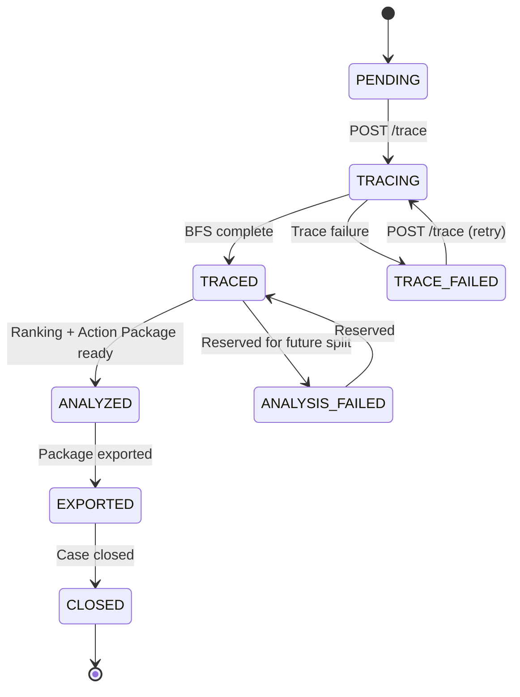

# ANVESHAK — Product Specification

> **Version**: 1.0.0-MVP  
> **Last Updated**: 2026-11-25  
> **Status**: APPROVED (Reconciled with `API_CONTRACT.md`, `DATA_MODEL.md`, and `DECISIONS.md`)  
> **Audience**: AI implementation agents, human reviewers

---

## 1. Product Overview

ANVESHAK is a complaint-to-action crypto investigation workflow for Indian law enforcement, built for SIH 2026 (PS ID: `SIH26183`, Team PHANTOMS). It transforms a victim's complaint and seed wallet address into a court-ready action package by tracing TRON blockchain fund flows, pruning the transaction graph, ranking VASP endpoints, assembling evidence, and exporting JSON + PDF bundles.

### 1.1 Pipeline Summary

```
Victim Complaint → Seed Wallet(s) → TRON Blockchain Tracing → Raw Graph
→ Pruned Graph (6 filters) → VASP Attribution & 6-Signal Ranking → Evidence Assembly → Action Package (JSON + PDF)
```

### 1.2 Tech Stack

| Layer | Technology | Version (minimum) |
|---|---|---|
| Backend API | FastAPI (Python) | 0.104+ (Python 3.11+) |
| Database | PostgreSQL | 16+ |
| Migrations | Alembic + SQLAlchemy (asyncpg) | 1.12+ / 2.0+ |
| Graph Engine | NetworkX | 3.2+ |
| Blockchain API | TronGrid REST API | v1 |
| Frontend | React + TypeScript (strict) + TailwindCSS | 18+ |
| Graph Visualization | Cytoscape.js (`cytoscape-dagre`) | 3.30+ |
| Containerization | Docker + Docker Compose | 24+ / 2.23+ |
| PDF Generation | ReportLab | 4.0+ |

---

## 2. User Roles

### 2.1 Role Definitions

| Role | Slug | Description |
|---|---|---|
| Investigating Officer | `investigating_officer` | Creates cases, initiates traces, reviews evidence, accepts/rejects VASP candidates, downloads action packages. Primary user. |
| Administrator | `admin` | Manages VASP label store, configures system settings, manages user accounts (Phase 2). |
| Viewer | `viewer` | Read-only access to all cases and evidence (Phase 2). |

### 2.2 Permission Matrix (Phase 2 Target)

| Action | `investigating_officer` | `admin` | `viewer` |
|---|---|---|---|
| List / view cases & graphs | ✅ | ✅ | ✅ |
| Create case / initiate trace | ✅ | ✅ | ❌ |
| Review (`accepted`/`rejected`) VASP candidates | ✅ | ✅ | ❌ |
| Export Action Package (JSON / PDF) | ✅ | ✅ | ❌ |
| Manage VASP labels (`POST /api/v1/labels`) | ✅ | ✅ | ❌ |
| Manage system settings / users (Phase 2) | ❌ | ✅ | ❌ |

### 2.3 MVP Authentication Strategy

> [!IMPORTANT]
> **For MVP, there is NO authentication or authorization.** All API endpoints are open on the trusted local/demo network and operate as `investigating_officer`. Phase 2 adds JWT Bearer auth and role-based access control.

---

## 3. Core Functional Capabilities (MVP Scope)

> **Wire Contract Rule:** Exact JSON fields, HTTP methods, paths, query parameters, and error payloads are governed by `docs/API_CONTRACT.md` and `docs/DATA_MODEL.md`. This section summarizes functional behavior.

### 3.1 Case Management
- **Create Case (`POST /api/v1/cases` → `201`):** Accepts `victim_name` (required, 1–255 chars), optional `victim_contact`, optional unique `complaint_id` (NCRP ref, max 50 chars, `^[A-Za-z0-9/_-]+$`), `reported_at` (required, ISO 8601 UTC, not future), `description` (required, 1–5000 chars), optional `tags` (0–10 tags), and `seed_wallets` (1–10 `SeedWalletInput` objects with `address`, `chain="TRON"`, `token="USDT"`, optional `reported_amount > 0`, optional `tx_hash`). Persists `Case` with status `PENDING`.
- **List Cases (`GET /api/v1/cases` → `200`):** Page-numbered pagination (`page`, `page_size` default 20 max 100) returning `{items, total, page, page_size, pages}`. Supports filters (`status`, `search` over `victim_name`/`complaint_id`, `date_from`, `date_to`) and sorting (`sort_by`, `sort_order`).
- **Get Case Detail (`GET /api/v1/cases/{case_id}` → `200`):** Full case record with `tags`, `seed_wallets`, `trace_config`, and `trace_summary`.

### 3.2 Automated Blockchain Trace & Attribution Pipeline
- **Trigger Trace (`POST /api/v1/cases/{case_id}/trace` → `202`):**
  - Precondition: Allowed ONLY when `status IN ('PENDING', 'TRACE_FAILED')`. Returns `409 Conflict` if `TRACING` or already `TRACED`/`ANALYZED`/`EXPORTED`/`CLOSED` (`docs/DECISIONS.md` §4).
  - Accepts optional trace configuration (`hop_limit` 1–5 default `3`, `time_window_before_days` 1–365 default `30`, `time_window_after_days` 0–90 default `7`, `degree_cap` 10–1000 default `100`, `amount_threshold_pct` 0.0–1.0 default `0.01`).
  - Spawns FastAPI background task:
    1. Fetches outgoing TRC-20 (USDT) & TRX transactions from `TronAdapter` (24h PostgreSQL cache + TronGrid API).
    2. Builds directed graph via level-synchronous BFS (`1..hop_limit`), applying the **6 canonical pruning filters in strict order** (`hop_limit`, `amount_below_threshold`, `time_window`, `degree_cap`, `path_discontinuity`, `duplicate`) per `docs/GRAPH_ENGINE.md`.
    3. Persists `trace_nodes` and `trace_edges` (`TRACED`), then runs **VASP Attribution & 6-Signal Ranking** (`docs/VASP_ATTRIBUTION.md`) and **Evidence & Action Package Assembly** (`docs/ACTION_PACKAGE_SPEC.md`), transitioning status to `ANALYZED`.
    4. On unrecoverable failure (>50% frontier fetch errors or fatal exception), sets status to `TRACE_FAILED`.
- **Get Graph (`GET /api/v1/cases/{case_id}/graph` → `200`):** Returns Cytoscape-ready `{nodes, edges, metadata}` (`include_pruned` bool query param, default `false`). Returns `{nodes: [], edges: [], metadata: null}` before trace runs.

### 3.3 VASP Attribution & Human Review
- **6-Signal Scoring Formula (`docs/VASP_ATTRIBUTION.md`):**
  - `confidence = 0.35 * label_match_score + 0.15 * hop_depth_score + 0.20 * amount_relevance_score + 0.10 * time_gap_score + 0.10 * path_continuity_score + 0.10 * degree_fanout_score`
  - Exact matching against `vasp_labels` (`agency` > `licensed` > `public` > `heuristic`), plus 3 behavioral heuristic detectors (`HEUR_SWEEP`, `HEUR_FANIN`, `HEUR_DEPOSIT_FWD`).
  - Candidates scoring `< 0.20` are excluded; up to `10` candidates ranked densely.
- **List Candidates (`GET /api/v1/cases/{case_id}/candidates` → `200`):** Returns ranked candidates with `scoring_breakdown`, `alternative_labels`, `evidence_path_ids`, and `review_status`.
- **Review Candidate (`POST /api/v1/cases/{case_id}/candidates/{candidate_id}/review` → `200`):** Updates `review_status` (`"accepted" | "rejected" | "pending"`) and `review_notes`.
- **VASP Label Store (`GET /api/v1/labels/search`, `POST /api/v1/labels`):** Search existing labels or add investigator-verified `agency` labels. Seeded idempotently with 20 synthetic MVP placeholder labels via `python -m app.scripts.seed_labels` (`docs/DECISIONS.md` §6).

### 3.4 Evidence & Action Package Export
- **Get Evidence (`GET /api/v1/cases/{case_id}/evidence` → `200`):** Full reconstructed seed-to-VASP paths, amounts, timestamps, TX hashes, and flow retention %.
- **Get Action Package JSON (`GET /api/v1/cases/{case_id}/action-package` → `200`):** Full JSON payload matching `docs/ACTION_PACKAGE_SPEC.md` §2 (deterministic CrPC 91 / CrPC 102 / IEA 65B recommendations + 8 Indian legal references + mandatory disclaimers).
- **Download Action Package PDF (`GET /api/v1/cases/{case_id}/action-package/export` → `200`):** Multi-page A4 ReportLab PDF (`Content-Type: application/pdf`).

---

## 4. Non-Goals (MVP)

| # | Non-Goal | Rationale |
|---|---|---|
| 1 | User authentication / authorization | Deferred to Phase 2. |
| 2 | EVM (Ethereum, Polygon, BSC) & Bitcoin execution | Architecture is abstracted via `ChainAdapter`, but MVP traces TRON only. |
| 3 | Real-time streaming / WebSockets | 3-second polling on `GET /api/v1/cases/{id}` while `status == "TRACING"` is sufficient. |
| 4 | Multi-tenancy | Single agency deployment. |
| 5 | Automated mixer / cross-chain bridge de-anonymization | Beyond MVP heuristics. |
| 6 | Live NCRP / I4C external API integration | Manual complaint ID entry in MVP. |
| 7 | Native mobile app | Desktop-first web workbench (`>= 1024px`). |

---

## 5. End-to-End User Workflows

### 5.1 Workflow 1: Create Case
1. Officer opens `/cases/new`, fills `Victim Name`, optional `Complaint ID`, `Reported Date & Time`, `Description`, `Tags`, and 1–10 `Seed Wallets`.
2. Frontend validates TRON address (`^T[1-9A-HJ-NP-Za-km-z]{33}$`) inline and submits `POST /api/v1/cases`.
3. Backend returns `201 Created` (`status: "PENDING"`). UI redirects to `/cases/{id}`.

### 5.2 Workflow 2: Trace & Graph Exploration
1. Officer clicks **"Start Trace"** (`POST /api/v1/cases/{id}/trace` → `202 {"status": "TRACING"}`).
2. Frontend polls `GET /api/v1/cases/{id}` every **3 seconds** while `status === "TRACING"`.
3. Backend completes BFS + pruning + attribution + evidence/action package assembly and transitions case to `ANALYZED` (or `TRACE_FAILED`).
4. Frontend fetches `GET /api/v1/cases/{id}/graph` and renders interactive Cytoscape.js graph with node/edge inspection drawer.

### 5.3 Workflow 3: Review VASP Candidates & Export PDF
1. Officer opens **Candidates** tab (`GET /api/v1/cases/{id}/candidates`), expands 6-signal scoring breakdown, and clicks **Accept** / **Reject** (`POST /api/v1/cases/{id}/candidates/{cid}/review`).
2. Officer reviews hop-by-hop **Evidence** paths (`GET /api/v1/cases/{id}/evidence`).
3. Officer opens **Action Package** tab and downloads JSON (`GET .../action-package`) or A4 PDF (`GET .../action-package/export`).

---

## 6. Case Status State Machine



Valid statuses enforced by DB `CHECK` constraint (`DATA_MODEL.md` §3.1): `PENDING`, `TRACING`, `TRACED`, `ANALYZED`, `EXPORTED`, `CLOSED`, `TRACE_FAILED`, `ANALYSIS_FAILED`.

---

## 7. Input Validation & Edge Cases

### 7.1 Validation Rules Summary
- **TRON Address:** `^T[1-9A-HJ-NP-Za-km-z]{33}$` (34 chars, Base58Check).
- **TX Hash:** `^[a-fA-F0-9]{64}$` (optional on seed wallet).
- **Reported Amount:** Optional, strictly `> 0` when provided.
- **Complaint ID:** Optional, unique when provided, max 50 chars, `^[A-Za-z0-9/_-]+$`.
- **Victim Name:** Required, 1–255 chars.
- **Description:** Required, 1–5000 chars.
- **Tags:** 0–10 tags, max 50 chars each, lowercase trimmed (`^[a-z0-9_-]+$`).
- **Error Format:** Standard FastAPI `{"detail": "..."}` for 400/404/409/500/503 and Pydantic list `{"detail": [{"loc": ..., "msg": ..., "type": ...}]}` for 422 (`API_CONTRACT.md` §1).

### 7.2 Key Edge Cases
1. **Zero Outgoing Transactions (Scenario C):** Trace completes cleanly with 1 seed node, 0 edges, 0 VASP candidates, and an action recommendation noting no VASP endpoints found within limits.
2. **Circular Flows (`A → B → C → A`):** Cycle edge is recorded for visibility, `cycles_detected` increments, and already-visited nodes are NOT re-expanded.
3. **TronGrid Rate Limits / Outages:** 24h DB transaction cache minimizes external calls; exponential backoff retries 429s; >50% frontier failures cleanly abort to `TRACE_FAILED`.
4. **Missing `seed_wallets.tx_hash`:** `time_gap_score` falls back cleanly per `docs/DECISIONS.md` §3.

---

## 8. Performance Targets (MVP)

| Metric | Target |
|---|---|
| Case creation (`POST /cases`) | < 500 ms |
| Trace initiation (`POST /trace`, `202`) | < 1 s |
| Trace completion (3 hops, cached/normal load) | < 5 minutes |
| Graph API (`GET /graph`, < 500 nodes) | < 2 s |
| PDF generation (`ReportLab`) | < 5 s |

---

## 9. Glossary

| Term | Definition |
|---|---|
| **ANVESHAK** | अन्वेषक ("Investigator") — automated crypto complaint-to-action system. |
| **Seed Wallet** | Suspect TRON address reported in the victim complaint (Hop 0). |
| **VASP** | Virtual Asset Service Provider (exchange, broker, custodian, mixer, bridge). |
| **Pruning** | Applying the 6 ordered filters (`hop_limit`, `amount_below_threshold`, `time_window`, `degree_cap`, `path_discontinuity`, `duplicate`) to suppress noise. |
| **Action Package** | Investigator-ready JSON + ReportLab PDF bundle containing CrPC 91/102 & IEA 65B outputs. |
| **I4C / NCRP** | Indian Cyber Crime Coordination Centre / National Cyber Crime Reporting Portal. |
| **SUN** | Smallest base unit of TRX (`1 TRX = 1,000,000 SUN`); TRC-20 USDT also uses 6 decimals. |

---

*End of Product Specification.*
