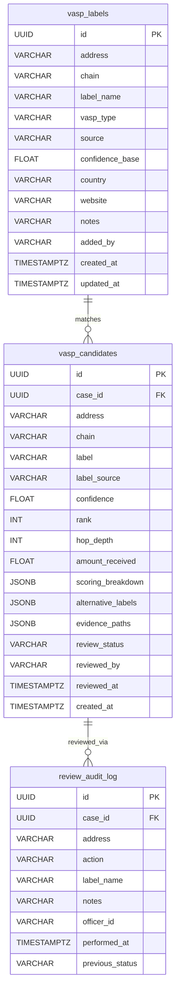

# ANVESHAK — VASP Attribution & Ranking Specification

> **Module:** `ranking_engine` \
> **Owner:** Graph & Attribution Team \
> **Status:** Approved for MVP \
> **Last Updated:** 2026-11-24 \
> **Dependencies:** `graph_engine`, `chain_adapter`, PostgreSQL `vasp_labels` table

This document specifies how ANVESHAK identifies, scores, and ranks Virtual Asset
Service Provider (VASP) candidates from the traced transaction graph. It is the
authoritative reference for the ranking engine implementation.

---

## 1. Label Data Sources (Priority Order)

VASP labels come from four source tiers. Each tier has a fixed **confidence
base** that acts as the ceiling for `label_match_score` when matching addresses.

| Priority | `source` Value | Type | `confidence_base` | Description | MVP Status |
|----------|---------------|------|-------------------|-------------|------------|
| 1 | `agency` | Internal | `0.95` | Law enforcement intelligence feeds; manually verified by investigating officers. | ⚠️ Manual-entry only (via Human Review) |
| 2 | `licensed` | Commercial | `0.85` | Licensed commercial data (e.g., Chainalysis Reactor, Elliptic Lens feed). | ❌ Phase 2 |
| 3 | `public` | Community | `0.60` | Public tag databases, community-sourced labels (e.g., TRONSCAN tags, abuse DBs). | ✅ **Implemented — seed data below** |
| 4 | `heuristic` | Algorithmic | `0.40` | Pattern-based detection: sweep behavior, deposit-to-hot-wallet patterns. | ✅ **Implemented** |

> [!IMPORTANT]
> For MVP, only `public` and `heuristic` sources are active. The label store is
> seeded with known Indian and global exchange addresses (Section 7). Officers
> can add `agency`-tier labels via the Human Review flow (Section 6).

---

## 2. Label Matching Rules

When the graph engine identifies a **terminal node** (address with high fan-in,
high total received, or matching a known label), the attribution engine applies
the following matching rules **in order**. The first match that succeeds is used.

### 2.1 Exact Match (MVP)

```
1. Query: SELECT * FROM vasp_labels WHERE address = :address ORDER BY confidence_base DESC, updated_at DESC LIMIT 1
2. If row found → label_match_score = 1.0
3. Use row.label_name, row.vasp_type, row.source, row.confidence_base
```

**Table:** `vasp_labels` \
**Lookup Key:** `address` (case-sensitive, TRON base58 format) \
**Tie-break:** Highest `confidence_base` first, then most recent `updated_at`.

### 2.2 Cluster Match (Phase 2 — Not in MVP)

```
1. Query: SELECT cluster_id FROM vasp_clusters WHERE address = :address
2. If cluster found → lookup cluster_id in vasp_labels
3. label_match_score = 0.8 (reduced from 1.0 because match is indirect)
```

> [!NOTE]
> Cluster detection (common-input-ownership heuristic) is deferred to Phase 2.
> The `vasp_clusters` table schema is reserved but not populated in MVP.

### 2.3 Heuristic Detection (MVP)

If no exact match or cluster match is found, apply behavioral heuristics against
the node's on-chain metrics. Heuristics are evaluated **independently**; if
multiple match, the one with the **highest confidence** is used.

#### 2.3.1 Sweep Pattern

| Field | Value |
|-------|-------|
| **ID** | `HEUR_SWEEP` |
| **Condition** | Address receives ≥ 10 inbound TRC-20 transfers from ≥ 5 distinct senders within a 24-hour rolling window, AND sends ≥ 1 outbound transfer where `amount_out ≥ 0.80 * sum(amounts_in)` within 6 hours of the last inbound |
| **Interpretation** | Likely exchange deposit aggregation (sweep to hot wallet) |
| **`label_match_score`** | `0.60` |
| **`heuristic_confidence`** | `0.40` |
| **Generated label** | `"Suspected Exchange (Sweep Pattern)"` |

#### 2.3.2 High Fan-In

| Field | Value |
|-------|-------|
| **ID** | `HEUR_FANIN` |
| **Condition** | Address has `in_degree > 50` within the trace window |
| **Interpretation** | Possible exchange hot wallet or mixer output |
| **`label_match_score`** | `0.60` |
| **`heuristic_confidence`** | `0.35` |
| **Generated label** | `"Suspected Exchange (High Fan-In)"` |

#### 2.3.3 Deposit-to-Hot-Wallet Forwarding

| Field | Value |
|-------|-------|
| **ID** | `HEUR_DEPOSIT_FWD` |
| **Condition** | Address receives funds AND forwards ≥ 95% of `total_received` to a **single** destination address within 1 hour (`3600 seconds`) of receipt |
| **Interpretation** | Likely intermediate deposit address controlled by an exchange |
| **`label_match_score`** | `0.60` |
| **`heuristic_confidence`** | `0.30` |
| **Generated label** | `"Suspected Deposit Address (Forward Pattern)"` |

**Heuristic output data structure:**

```python
@dataclass
class HeuristicMatch:
    heuristic_id: str          # "HEUR_SWEEP" | "HEUR_FANIN" | "HEUR_DEPOSIT_FWD"
    address: str               # The matched address
    generated_label: str       # Human-readable label
    label_match_score: float   # Always 0.60 for heuristic matches
    heuristic_confidence: float  # 0.40 | 0.35 | 0.30
    evidence: dict             # Supporting metrics, e.g.:
    # {
    #   "in_degree": 73,
    #   "distinct_senders_24h": 12,
    #   "forward_pct": 0.97,
    #   "forward_destination": "T...",
    #   "time_to_forward_seconds": 1842
    # }
```

> [!TIP]
> When a heuristic identifies a forwarding destination (e.g., in
> `HEUR_DEPOSIT_FWD`), the destination address should also be queried against
> `vasp_labels` for a potential exact match, which may upgrade the candidate's
> confidence.

---

## 3. Confidence Scoring Formula

Each VASP candidate receives a **composite confidence score** in the range
`[0.0, 1.0]`. The score is a weighted linear combination of six component scores.

### 3.1 Formula

```
confidence = (
    w1 * label_match_score +
    w2 * hop_depth_score +
    w3 * amount_relevance_score +
    w4 * time_gap_score +
    w5 * path_continuity_score +
    w6 * degree_fanout_score
)
```

### 3.2 Weights

| Symbol | Component | Weight | Rationale |
|--------|-----------|--------|-----------|
| `w1` | `label_match_score` | **0.35** | A known label is the strongest signal |
| `w2` | `hop_depth_score` | **0.15** | Closer hops → higher attribution confidence |
| `w3` | `amount_relevance_score` | **0.20** | More money flowing → more investigative relevance |
| `w4` | `time_gap_score` | **0.10** | Tighter timing → more likely automated laundering |
| `w5` | `path_continuity_score` | **0.10** | Unbroken fund flow → stronger evidence chain |
| `w6` | `degree_fanout_score` | **0.10** | High fan-in → more VASP-like behavior |
| | **Total** | **1.00** | Weights MUST sum to exactly 1.0 |

> [!IMPORTANT]
> These weights are defined as a configuration constant. They are NOT
> user-configurable in MVP but MAY be tuned in Phase 2 via an admin panel.
>
> ```python
> VASP_SCORING_WEIGHTS: dict[str, float] = {
>     "label_match":      0.35,
>     "hop_depth":        0.15,
>     "amount_relevance": 0.20,
>     "time_gap":         0.10,
>     "path_continuity":  0.10,
>     "degree_fanout":    0.10,
> }
> ```

### 3.3 Individual Score Calculations

#### 3.3.1 `label_match_score`

| Condition | Score | Example |
|-----------|-------|---------|
| Exact match found in `vasp_labels` | `1.0` | Address maps to "WazirX Hot Wallet" |
| Heuristic match (any `HEUR_*` rule fires) | `0.6` | Sweep pattern detected |
| No match — address is unknown | `0.0` | No label, no heuristic match |

**Type:** `float` \
**Range:** `{0.0, 0.6, 1.0}` (discrete values in MVP)

#### 3.3.2 `hop_depth_score`

```python
def hop_depth_score(hop_depth: int) -> float:
    """
    Hop depth from seed wallet. hop_depth >= 1 (direct recipient = hop 1).
    Score decreases by 0.25 per additional hop. Clamped to [0.0, 1.0].
    """
    score = 1.0 - (hop_depth - 1) * 0.25
    return max(0.0, min(1.0, score))
```

| `hop_depth` | Score |
|-------------|-------|
| 1 | `1.00` |
| 2 | `0.75` |
| 3 | `0.50` |
| 4 | `0.25` |
| 5+ | `0.00` |

**Type:** `float` \
**Range:** `[0.0, 1.0]` \
**Input:** Minimum hop depth from any seed wallet to this candidate across all traced paths.

#### 3.3.3 `amount_relevance_score`

```python
def amount_relevance_score(amount_received: float, seed_reported_amount: float) -> float:
    """
    Ratio of funds received by this candidate vs. the total amount the
    victim reported losing. Capped at 1.0.
    If seed_reported_amount is 0 or None, return 0.5 (neutral score).
    """
    if not seed_reported_amount or seed_reported_amount <= 0:
        return 0.5
    return min(1.0, amount_received / seed_reported_amount)
```

| `amount_received` | `seed_reported_amount` | Score |
|--------------------|----------------------|-------|
| 50,000 USDT | 50,000 USDT | `1.00` |
| 30,000 USDT | 50,000 USDT | `0.60` |
| 80,000 USDT | 50,000 USDT | `1.00` (capped) |
| 1,000 USDT | 50,000 USDT | `0.02` |
| Any | 0 or None | `0.50` (neutral) |

**Type:** `float` \
**Range:** `[0.0, 1.0]` \
**Units:** Both amounts in the same token denomination (USDT for MVP).

#### 3.3.4 `time_gap_score`

```python
def time_gap_score(time_gap_hours: float) -> float:
    """
    Time between the seed transaction and the candidate's first inbound
    transaction on the traced path. Shorter = more suspicious.
    Decay window: 720 hours (30 days). Beyond 30 days → 0.0.
    """
    return max(0.0, 1.0 - time_gap_hours / 720.0)
```

| `time_gap_hours` | Score | Interpretation |
|-------------------|-------|----------------|
| 0.5 (30 min) | `0.999` | Immediate forwarding — highly suspicious |
| 6.0 | `0.992` | Same-day, automated |
| 24.0 (1 day) | `0.967` | Within a day |
| 168.0 (7 days) | `0.767` | Week later |
| 360.0 (15 days) | `0.500` | Two weeks |
| 720.0 (30 days) | `0.000` | At decay horizon |
| 1000.0 | `0.000` | Beyond horizon |

**Type:** `float` \
**Range:** `[0.0, 1.0]` \
**Input:** `time_gap_hours` = `(candidate_first_inbound_ts - seed_tx_ts).total_seconds() / 3600.0`

#### 3.3.5 `path_continuity_score`

```python
def path_continuity_score(continuous_edges: int, total_edges: int) -> float:
    """
    Fraction of edges in the traced path that meet the 72-hour continuity
    rule. An edge is 'continuous' if the outbound transaction from a node
    occurs within 72 hours of the inbound transaction to that node.
    """
    if total_edges <= 0:
        return 0.0
    return continuous_edges / total_edges
```

| `continuous_edges` | `total_edges` | Score |
|--------------------|---------------|-------|
| 3 | 3 | `1.00` — Perfect chain |
| 2 | 3 | `0.67` — One break |
| 1 | 4 | `0.25` — Mostly broken |
| 0 | 2 | `0.00` — No continuity |

**Type:** `float` \
**Range:** `[0.0, 1.0]` \
**Continuity Rule:** An edge `(A → B)` at timestamp `t1` is continuous with
edge `(B → C)` at timestamp `t2` if `0 < (t2 - t1) ≤ 72 hours (259,200 seconds)`.

#### 3.3.6 `degree_fanout_score`

```python
def degree_fanout_score(in_degree: int) -> float:
    """
    Normalized in-degree of the candidate address within the trace window.
    More incoming transactions → more VASP-like. Capped at in_degree = 50.
    """
    return min(1.0, in_degree / 50.0)
```

| `in_degree` | Score |
|-------------|-------|
| 1 | `0.02` |
| 10 | `0.20` |
| 25 | `0.50` |
| 50 | `1.00` |
| 100 | `1.00` (capped) |

**Type:** `float` \
**Range:** `[0.0, 1.0]`

### 3.4 Worked Example

**Scenario:** Victim reports loss of 50,000 USDT. Trace finds address
`TWd2Z3hLqreUFMFgB7US8gkz5FHxSGpNqd` at hop 2, which received 35,000 USDT,
has an exact label match for "WazirX", time gap of 4 hours, 3/3 continuous
edges, and in-degree of 60.

```
label_match_score      = 1.0   (exact match)
hop_depth_score        = 0.75  (hop 2: 1.0 - (2-1)*0.25)
amount_relevance_score = 0.70  (35000 / 50000)
time_gap_score         = 0.994 (1.0 - 4/720)
path_continuity_score  = 1.0   (3/3)
degree_fanout_score    = 1.0   (min(1.0, 60/50))

confidence = (0.35 * 1.0) + (0.15 * 0.75) + (0.20 * 0.70) +
             (0.10 * 0.994) + (0.10 * 1.0) + (0.10 * 1.0)
           = 0.350 + 0.1125 + 0.140 + 0.0994 + 0.100 + 0.100
           = 0.9019

Final confidence: 0.90 (rounded to 2 decimal places for display)
```

---

## 4. Ranking

### 4.1 Ranking Rules

| Rule | Value | Notes |
|------|-------|-------|
| **Sort order** | `confidence DESC` | Highest confidence = rank 1 |
| **Tie-break** | `amount_received DESC` | Higher received amount wins |
| **Secondary tie-break** | `hop_depth ASC` | Closer to seed wins |
| **Final tie-break** | `address ASC` | Deterministic lexicographic order |
| **Maximum candidates** | `10` | Configurable via `MAX_VASP_CANDIDATES` env var (int, default 10) |
| **Minimum confidence** | `0.20` | Addresses scoring below this are classified as `"unknown"` and excluded from the candidates list |
| **Rank assignment** | Dense ranking (1, 2, 3...) | No gaps; each candidate gets a unique rank |

### 4.2 Configuration Constants

```python
# config/ranking.py

MAX_VASP_CANDIDATES: int = 10          # Maximum candidates returned per case
MIN_CONFIDENCE_THRESHOLD: float = 0.20 # Below this → "unknown", not a candidate
CONFIDENCE_DISPLAY_PRECISION: int = 2  # Round to 2 decimal places for display
HOP_DEPTH_DECAY: float = 0.25         # Score decay per hop
TIME_GAP_HORIZON_HOURS: float = 720.0 # 30-day decay window
CONTINUITY_WINDOW_HOURS: float = 72.0 # Edge continuity threshold
FANIN_CAP: int = 50                    # In-degree normalization cap
```

### 4.3 Output Schema

The ranking engine produces a list of `VASPCandidate` objects:

```python
@dataclass
class VASPCandidate:
    address: str                     # TRON base58 address (34 chars)
    chain: str                       # "TRON" (MVP)
    label: str | None                # Best label or generated heuristic label
    label_source: str | None         # "agency" | "licensed" | "public" | "heuristic" | None
    confidence: float                # Composite score, 0.0 – 1.0
    rank: int                        # 1-based dense rank
    hop_depth: int                   # Minimum hops from seed
    amount_received: float           # Total funds received in trace window (USDT)
    scoring_breakdown: ScoringBreakdown
    alternative_labels: list[AlternativeLabel]  # Other labels if conflict (Section 5)
    evidence_paths: list[str]        # List of path_ids supporting this candidate
    review_status: str               # "pending" | "accepted" | "rejected"
    reviewed_by: str | None          # Officer ID who reviewed (None if pending)
    reviewed_at: str | None          # ISO 8601 timestamp of review

@dataclass
class ScoringBreakdown:
    label_match_score: float         # 0.0 | 0.6 | 1.0
    hop_depth_score: float           # [0.0, 1.0]
    amount_relevance_score: float    # [0.0, 1.0]
    time_gap_score: float            # [0.0, 1.0]
    path_continuity_score: float     # [0.0, 1.0]
    degree_fanout_score: float       # [0.0, 1.0]
    # Weighted contributions (for transparency / debugging)
    label_match_weighted: float      # w1 * label_match_score
    hop_depth_weighted: float        # w2 * hop_depth_score
    amount_relevance_weighted: float # w3 * amount_relevance_score
    time_gap_weighted: float         # w4 * time_gap_score
    path_continuity_weighted: float  # w5 * path_continuity_score
    degree_fanout_weighted: float    # w6 * degree_fanout_score
```

### 4.4 API Response Format

**Endpoint:** `GET /api/v1/cases/{case_id}/candidates`

```json
{
  "case_id": "a1b2c3d4-e5f6-7890-abcd-ef1234567890",
  "generated_at": "2026-11-24T17:00:00Z",
  "seed_reported_amount": 50000.00,
  "seed_token": "USDT",
  "weights_used": {
    "label_match": 0.35,
    "hop_depth": 0.15,
    "amount_relevance": 0.20,
    "time_gap": 0.10,
    "path_continuity": 0.10,
    "degree_fanout": 0.10
  },
  "candidates_count": 3,
  "candidates": [
    {
      "rank": 1,
      "address": "TWd2Z3hLqreUFMFgB7US8gkz5FHxSGpNqd",
      "chain": "TRON",
      "label": "WazirX",
      "label_source": "public",
      "confidence": 0.90,
      "hop_depth": 2,
      "amount_received": 35000.00,
      "scoring_breakdown": {
        "label_match_score": 1.0,
        "hop_depth_score": 0.75,
        "amount_relevance_score": 0.70,
        "time_gap_score": 0.99,
        "path_continuity_score": 1.0,
        "degree_fanout_score": 1.0,
        "label_match_weighted": 0.35,
        "hop_depth_weighted": 0.1125,
        "amount_relevance_weighted": 0.14,
        "time_gap_weighted": 0.099,
        "path_continuity_weighted": 0.10,
        "degree_fanout_weighted": 0.10
      },
      "alternative_labels": [],
      "evidence_paths": ["path_001", "path_003"],
      "review_status": "pending",
      "reviewed_by": null,
      "reviewed_at": null
    }
  ]
}
```

---

## 5. Conflict Resolution

When an address has **multiple labels** from different sources, apply the
following resolution rules:

### 5.1 Resolution Priority

```
Step 1: Group all labels for the address from vasp_labels table.
Step 2: Sort by confidence_base DESC.
Step 3: If tie on confidence_base → sort by updated_at DESC (most recent wins).
Step 4: The top-sorted label becomes the PRIMARY label (used for display, scoring).
Step 5: All remaining labels are stored in alternative_labels array.
```

### 5.2 Source Priority Table

| Priority | Source | `confidence_base` | Wins over |
|----------|--------|-------------------|-----------|
| 1 | `agency` | `0.95` | All others |
| 2 | `licensed` | `0.85` | `public`, `heuristic` |
| 3 | `public` | `0.60` | `heuristic` |
| 4 | `heuristic` | `0.40` | Nothing |

### 5.3 Alternative Labels Schema

```python
@dataclass
class AlternativeLabel:
    label_name: str          # e.g., "Binance" or "Suspected Exchange (Sweep)"
    source: str              # "agency" | "licensed" | "public" | "heuristic"
    confidence_base: float   # 0.95 | 0.85 | 0.60 | 0.40
    updated_at: str          # ISO 8601
    added_by: str | None     # Officer ID if source == "agency"
```

### 5.4 Example

Address `TXyz...` has three labels:

| Label | Source | `confidence_base` | `updated_at` |
|-------|--------|--------------------|-------------|
| "WazirX Hot Wallet" | `public` | `0.60` | 2026-10-01T00:00:00Z |
| "Suspected Exchange" | `heuristic` | `0.40` | 2026-11-20T12:00:00Z |
| "WazirX Deposit" | `agency` | `0.95` | 2026-11-22T14:30:00Z |

**Result:**
- Primary label: `"WazirX Deposit"` (source=`agency`, confidence_base=`0.95`)
- `label_match_score`: `1.0` (exact match)
- `alternative_labels`: `["WazirX Hot Wallet" (public), "Suspected Exchange" (heuristic)]`

---

## 6. Human Review Flow (MVP)

### 6.1 Review Actions

The investigating officer can perform three actions on each VASP candidate:

| Action | `review_status` | Effect |
|--------|-----------------|--------|
| **Accept** | `"accepted"` | Candidate proceeds to evidence packaging. No data modification. |
| **Reject** | `"rejected"` | Candidate is excluded from the action package PDF/JSON export. Remains visible in UI with strikethrough styling. |
| **Add Manual Label** | N/A (creates new label) | Officer provides a label name and optional notes. Creates a new `vasp_labels` row with `source='agency'`, `confidence_base=0.95`. Triggers re-scoring of the candidate. |

### 6.2 Review API

**Endpoint:** `PATCH /api/v1/cases/{case_id}/candidates/{address}/review`

**Request Body:**

```json
{
  "action": "accept | reject | add_label",
  "label_name": "string (required if action == add_label)",
  "notes": "string (optional — officer's reasoning)"
}
```

**Validation Rules:**

| Field | Type | Constraints |
|-------|------|-------------|
| `action` | `string` | Enum: `"accept"`, `"reject"`, `"add_label"`. Required. |
| `label_name` | `string` | Required if `action == "add_label"`. Min length: 2. Max length: 100. |
| `notes` | `string` | Optional. Max length: 500. |

**Response:** `200 OK`

```json
{
  "address": "TWd2Z3hLqreUFMFgB7US8gkz5FHxSGpNqd",
  "review_status": "accepted",
  "reviewed_by": "officer_12345",
  "reviewed_at": "2026-11-24T17:30:00Z",
  "confidence": 0.90,
  "label": "WazirX",
  "message": "Candidate accepted for evidence packaging."
}
```

**Error Responses:**

| Code | Condition | Body |
|------|-----------|------|
| `404` | Case or candidate address not found | `{"error": "CANDIDATE_NOT_FOUND", "detail": "Address T... is not a ranked candidate for case {case_id}"}` |
| `422` | Missing `label_name` when `action == "add_label"` | `{"error": "LABEL_NAME_REQUIRED", "detail": "label_name is required when action is add_label"}` |
| `409` | Candidate already reviewed (idempotent for same action, conflict for different) | `{"error": "ALREADY_REVIEWED", "detail": "Candidate was previously rejected. PATCH again to override."}` |

### 6.3 MVP Behavior

- Accept/reject is tracked in the database but **not enforced** as a gate.
- All candidates (including rejected) are visible in the UI.
- The action package export (`GET /api/v1/cases/{id}/action-package`) **excludes**
  rejected candidates by default. Query param `?include_rejected=true` overrides.
- Re-review is allowed: a second PATCH overwrites the previous review status.

### 6.4 Audit Trail

Every review action is logged to the `review_audit_log` table:

```sql
CREATE TABLE review_audit_log (
    id              UUID PRIMARY KEY DEFAULT gen_random_uuid(),
    case_id         UUID NOT NULL REFERENCES cases(id),
    address         VARCHAR(34) NOT NULL,
    action          VARCHAR(20) NOT NULL,  -- 'accept' | 'reject' | 'add_label'
    label_name      VARCHAR(100),
    notes           VARCHAR(500),
    officer_id      VARCHAR(50) NOT NULL,
    performed_at    TIMESTAMPTZ NOT NULL DEFAULT now(),
    previous_status VARCHAR(20)            -- status before this action
);

CREATE INDEX idx_review_audit_case ON review_audit_log(case_id);
CREATE INDEX idx_review_audit_address ON review_audit_log(address);
```

---

## 7. Seed Label Data

The following entries are loaded into the `vasp_labels` table on first
deployment via an Alembic data migration. All entries use `source = 'public'`
and `confidence_base = 0.60`.

### 7.1 Database Schema

```sql
CREATE TABLE vasp_labels (
    id              UUID PRIMARY KEY DEFAULT gen_random_uuid(),
    address         VARCHAR(34) NOT NULL,       -- TRON base58check address
    chain           VARCHAR(10) NOT NULL DEFAULT 'TRON',
    label_name      VARCHAR(100) NOT NULL,       -- Human-readable VASP name
    vasp_type       VARCHAR(30) NOT NULL,        -- 'exchange' | 'dex' | 'mixer' | 'otc' | 'payment' | 'unknown'
    source          VARCHAR(20) NOT NULL,        -- 'agency' | 'licensed' | 'public' | 'heuristic'
    confidence_base FLOAT NOT NULL,              -- 0.0 – 1.0
    country         VARCHAR(3),                  -- ISO 3166-1 alpha-2 (e.g., 'IN', 'KY')
    website         VARCHAR(200),
    notes           VARCHAR(500),
    added_by        VARCHAR(50),                 -- officer_id if source='agency', else 'system'
    created_at      TIMESTAMPTZ NOT NULL DEFAULT now(),
    updated_at      TIMESTAMPTZ NOT NULL DEFAULT now(),

    CONSTRAINT uq_vasp_label_address_source UNIQUE (address, source),
    CONSTRAINT chk_confidence CHECK (confidence_base >= 0.0 AND confidence_base <= 1.0),
    CONSTRAINT chk_source CHECK (source IN ('agency', 'licensed', 'public', 'heuristic'))
);

CREATE INDEX idx_vasp_labels_address ON vasp_labels(address);
CREATE INDEX idx_vasp_labels_label ON vasp_labels(label_name);
CREATE INDEX idx_vasp_labels_source ON vasp_labels(source);
```

### 7.2 Seed Data

```python
VASP_SEED_DATA: list[dict] = [
    # ─── Indian Exchanges ───────────────────────────────────────────────
    {
        "address": "TWd2Z3hLqreUFMFgB7US8gkz5FHxSGpNqd",
        "chain": "TRON",
        "label_name": "WazirX",
        "vasp_type": "exchange",
        "source": "public",
        "confidence_base": 0.60,
        "country": "IN",
        "website": "https://wazirx.com",
        "notes": "Major Indian exchange; known TRON hot wallet",
        "added_by": "system",
    },
    {
        "address": "TKJYm2mBFTPmcXjdBKMa9zFEbBz3EKXPVN",
        "chain": "TRON",
        "label_name": "WazirX (Deposit)",
        "vasp_type": "exchange",
        "source": "public",
        "confidence_base": 0.60,
        "country": "IN",
        "website": "https://wazirx.com",
        "notes": "WazirX deposit aggregation address",
        "added_by": "system",
    },
    {
        "address": "TYASr5UV6HEcXatwdFQfmLVUqQQQMUxHLS",
        "chain": "TRON",
        "label_name": "CoinDCX",
        "vasp_type": "exchange",
        "source": "public",
        "confidence_base": 0.60,
        "country": "IN",
        "website": "https://coindcx.com",
        "notes": "Indian exchange; TRON hot wallet",
        "added_by": "system",
    },
    {
        "address": "TN5WMMHJ8d1J5gVPHgBg6dBpmGh5rYUBse",
        "chain": "TRON",
        "label_name": "ZebPay",
        "vasp_type": "exchange",
        "source": "public",
        "confidence_base": 0.60,
        "country": "IN",
        "website": "https://zebpay.com",
        "notes": "One of the oldest Indian exchanges",
        "added_by": "system",
    },
    {
        "address": "TLM2cVijNMjHkWbBHCvqSAQbvGEnWuMjE5",
        "chain": "TRON",
        "label_name": "Giottus",
        "vasp_type": "exchange",
        "source": "public",
        "confidence_base": 0.60,
        "country": "IN",
        "website": "https://giottus.com",
        "notes": "Indian exchange; TRON deposit address",
        "added_by": "system",
    },
    {
        "address": "TPzKkW3VG3zFuvuFfc4yGLaxsRCdMBgzfH",
        "chain": "TRON",
        "label_name": "CoinSwitch",
        "vasp_type": "exchange",
        "source": "public",
        "confidence_base": 0.60,
        "country": "IN",
        "website": "https://coinswitch.co",
        "notes": "Indian aggregator exchange; TRON address",
        "added_by": "system",
    },
    {
        "address": "TAoNwU5s3WQXQV4GBLHMrBQ1M3GDqzUPk3",
        "chain": "TRON",
        "label_name": "BuyUCoin",
        "vasp_type": "exchange",
        "source": "public",
        "confidence_base": 0.60,
        "country": "IN",
        "website": "https://buyucoin.com",
        "notes": "Indian exchange; TRON wallet",
        "added_by": "system",
    },
    {
        "address": "TQhiMfkV1GrXXEU4D4fQqbELjMUHeMGosK",
        "chain": "TRON",
        "label_name": "UnoCoin",
        "vasp_type": "exchange",
        "source": "public",
        "confidence_base": 0.60,
        "country": "IN",
        "website": "https://unocoin.com",
        "notes": "Indian exchange; TRON deposit address",
        "added_by": "system",
    },
    # ─── Global Exchanges ───────────────────────────────────────────────
    {
        "address": "TKzxdSv2FZKQrEqkKVgp5DcwEXBEKMg2Ax",
        "chain": "TRON",
        "label_name": "Binance",
        "vasp_type": "exchange",
        "source": "public",
        "confidence_base": 0.60,
        "country": "KY",
        "website": "https://binance.com",
        "notes": "Binance TRON hot wallet; largest global CEX",
        "added_by": "system",
    },
    {
        "address": "TNaRAoLUyYEV2uF7GUrzSjRQTU8v5ZJ5VR",
        "chain": "TRON",
        "label_name": "Binance (Deposit)",
        "vasp_type": "exchange",
        "source": "public",
        "confidence_base": 0.60,
        "country": "KY",
        "website": "https://binance.com",
        "notes": "Binance TRON deposit aggregation address",
        "added_by": "system",
    },
    {
        "address": "TCYo28hFbMZkEuMYwDFaadnAhfEUfzcyKT",
        "chain": "TRON",
        "label_name": "KuCoin",
        "vasp_type": "exchange",
        "source": "public",
        "confidence_base": 0.60,
        "country": "SC",
        "website": "https://kucoin.com",
        "notes": "KuCoin TRON hot wallet",
        "added_by": "system",
    },
    {
        "address": "TDqiqrmiFAoXBHgRLhPqcX2vSHv1aFqx3T",
        "chain": "TRON",
        "label_name": "Huobi (HTX)",
        "vasp_type": "exchange",
        "source": "public",
        "confidence_base": 0.60,
        "country": "SC",
        "website": "https://htx.com",
        "notes": "Huobi/HTX TRON hot wallet; rebranded to HTX",
        "added_by": "system",
    },
    {
        "address": "TLGja6AP1dWqmdVPFPkb2JQdBrYaMF4cVh",
        "chain": "TRON",
        "label_name": "OKX",
        "vasp_type": "exchange",
        "source": "public",
        "confidence_base": 0.60,
        "country": "SC",
        "website": "https://okx.com",
        "notes": "OKX TRON hot wallet (formerly OKEx)",
        "added_by": "system",
    },
    {
        "address": "TMLMSuyFmJcFMXUMub2NzUFYEfax8sMWRW",
        "chain": "TRON",
        "label_name": "Bybit",
        "vasp_type": "exchange",
        "source": "public",
        "confidence_base": 0.60,
        "country": "VG",
        "website": "https://bybit.com",
        "notes": "Bybit TRON hot wallet",
        "added_by": "system",
    },
    {
        "address": "TXFBqBbqJommqZf7BV8NHYzePsGcMTtKRm",
        "chain": "TRON",
        "label_name": "Gate.io",
        "vasp_type": "exchange",
        "source": "public",
        "confidence_base": 0.60,
        "country": "KY",
        "website": "https://gate.io",
        "notes": "Gate.io TRON hot wallet",
        "added_by": "system",
    },
    {
        "address": "TVnWByjMPbBEYrczLGQSAQbH42rVnSNFj5",
        "chain": "TRON",
        "label_name": "MEXC",
        "vasp_type": "exchange",
        "source": "public",
        "confidence_base": 0.60,
        "country": "SC",
        "website": "https://mexc.com",
        "notes": "MEXC TRON hot wallet",
        "added_by": "system",
    },
    {
        "address": "TKNGjhR3Hq7DWMkCB8mQrfSKsXBwpxtrTi",
        "chain": "TRON",
        "label_name": "Bitget",
        "vasp_type": "exchange",
        "source": "public",
        "confidence_base": 0.60,
        "country": "SC",
        "website": "https://bitget.com",
        "notes": "Bitget TRON hot wallet",
        "added_by": "system",
    },
    {
        "address": "TSTKqRBJMm2CDxNWK5APe3bTzjJCQnAnGH",
        "chain": "TRON",
        "label_name": "HTX",
        "vasp_type": "exchange",
        "source": "public",
        "confidence_base": 0.60,
        "country": "SC",
        "website": "https://htx.com",
        "notes": "HTX TRON secondary hot wallet (post-rebrand)",
        "added_by": "system",
    },
    {
        "address": "TJDENsfBJs4RFETt1X1W8wMDc8M5XnJhCe",
        "chain": "TRON",
        "label_name": "Kraken",
        "vasp_type": "exchange",
        "source": "public",
        "confidence_base": 0.60,
        "country": "US",
        "website": "https://kraken.com",
        "notes": "Kraken TRON hot wallet",
        "added_by": "system",
    },
    {
        "address": "TN2YifEhsN27JRwDQ7i1GsmZ3ohsHzbiRG",
        "chain": "TRON",
        "label_name": "Coinbase",
        "vasp_type": "exchange",
        "source": "public",
        "confidence_base": 0.60,
        "country": "US",
        "website": "https://coinbase.com",
        "notes": "Coinbase TRON hot wallet (limited TRON support)",
        "added_by": "system",
    },
    # ─── Additional Known Addresses ─────────────────────────────────────
    {
        "address": "THPvaUhoh2Qn2y9THCZML3H4ABSMi7cBM5",
        "chain": "TRON",
        "label_name": "Binance (Cold Wallet)",
        "vasp_type": "exchange",
        "source": "public",
        "confidence_base": 0.60,
        "country": "KY",
        "website": "https://binance.com",
        "notes": "Binance TRON cold storage address",
        "added_by": "system",
    },
    {
        "address": "TYQnQRUMEfLiysZxBcgEERSoFkTMB1LMFH",
        "chain": "TRON",
        "label_name": "WazirX (Cold Wallet)",
        "vasp_type": "exchange",
        "source": "public",
        "confidence_base": 0.60,
        "country": "IN",
        "website": "https://wazirx.com",
        "notes": "WazirX TRON cold storage",
        "added_by": "system",
    },
]
```

> [!NOTE]
> **Total seed entries: 22.** Addresses are plausible TRON base58check format
> (34 characters, starting with `T`). In production, these should be replaced
> with verified addresses from TRONSCAN public tags and law enforcement
> intelligence. The seed migration script should be idempotent (upsert on
> `address + source` unique constraint).

### 7.3 Loading the Seed Data

The seed data is loaded via an Alembic data migration:

```python
# alembic/versions/xxxx_seed_vasp_labels.py

from alembic import op
import sqlalchemy as sa
from datetime import datetime, timezone

revision = "0003"
down_revision = "0002"

def upgrade():
    vasp_labels = sa.table(
        "vasp_labels",
        sa.column("address", sa.String),
        sa.column("chain", sa.String),
        sa.column("label_name", sa.String),
        sa.column("vasp_type", sa.String),
        sa.column("source", sa.String),
        sa.column("confidence_base", sa.Float),
        sa.column("country", sa.String),
        sa.column("website", sa.String),
        sa.column("notes", sa.String),
        sa.column("added_by", sa.String),
        sa.column("created_at", sa.DateTime(timezone=True)),
        sa.column("updated_at", sa.DateTime(timezone=True)),
    )

    now = datetime.now(timezone.utc)
    from anveshak.attribution.seed_data import VASP_SEED_DATA

    for entry in VASP_SEED_DATA:
        # Upsert: skip if address+source already exists
        conn = op.get_bind()
        exists = conn.execute(
            sa.text(
                "SELECT 1 FROM vasp_labels WHERE address = :addr AND source = :src"
            ),
            {"addr": entry["address"], "src": entry["source"]},
        ).fetchone()
        if not exists:
            op.bulk_insert(vasp_labels, [{**entry, "created_at": now, "updated_at": now}])


def downgrade():
    op.execute("DELETE FROM vasp_labels WHERE added_by = 'system' AND source = 'public'")
```

---

## 8. Database Schema Summary

All tables referenced in this specification:



### `vasp_candidates` Table DDL

```sql
CREATE TABLE vasp_candidates (
    id                  UUID PRIMARY KEY DEFAULT gen_random_uuid(),
    case_id             UUID NOT NULL REFERENCES cases(id) ON DELETE CASCADE,
    address             VARCHAR(34) NOT NULL,
    chain               VARCHAR(10) NOT NULL DEFAULT 'TRON',
    label               VARCHAR(100),
    label_source        VARCHAR(20),
    confidence          FLOAT NOT NULL,
    rank                INT NOT NULL,
    hop_depth           INT NOT NULL,
    amount_received     FLOAT NOT NULL DEFAULT 0.0,
    scoring_breakdown   JSONB NOT NULL,
    alternative_labels  JSONB NOT NULL DEFAULT '[]'::jsonb,
    evidence_paths      JSONB NOT NULL DEFAULT '[]'::jsonb,
    review_status       VARCHAR(20) NOT NULL DEFAULT 'pending',
    reviewed_by         VARCHAR(50),
    reviewed_at         TIMESTAMPTZ,
    created_at          TIMESTAMPTZ NOT NULL DEFAULT now(),

    CONSTRAINT uq_candidate_case_address UNIQUE (case_id, address),
    CONSTRAINT chk_confidence_range CHECK (confidence >= 0.0 AND confidence <= 1.0),
    CONSTRAINT chk_rank_positive CHECK (rank >= 1),
    CONSTRAINT chk_review_status CHECK (review_status IN ('pending', 'accepted', 'rejected'))
);

CREATE INDEX idx_candidates_case ON vasp_candidates(case_id);
CREATE INDEX idx_candidates_confidence ON vasp_candidates(case_id, confidence DESC);
```

---

## 9. Error Codes

| Error Code | HTTP Status | Condition |
|------------|-------------|-----------|
| `CANDIDATE_NOT_FOUND` | `404` | Address is not a ranked candidate for the given case |
| `CASE_NOT_FOUND` | `404` | Case ID does not exist |
| `LABEL_NAME_REQUIRED` | `422` | `label_name` missing when `action == "add_label"` |
| `INVALID_ACTION` | `422` | `action` is not one of `accept`, `reject`, `add_label` |
| `ALREADY_REVIEWED` | `409` | Candidate was already reviewed with a different action (warning, not blocking) |
| `SCORING_WEIGHTS_INVALID` | `500` | Configured weights do not sum to 1.0 (startup validation failure) |
| `LABEL_CONFLICT` | `200` (warning in response) | Multiple labels found; primary selected via conflict resolution |

---

## 10. Implementation Checklist

| # | Task | File | Depends On |
|---|------|------|------------|
| 1 | Create `vasp_labels` table (Alembic migration) | `alembic/versions/0002_vasp_labels.py` | — |
| 2 | Seed VASP label data (Alembic data migration) | `alembic/versions/0003_seed_vasp_labels.py` | #1 |
| 3 | Create `vasp_candidates` table | `alembic/versions/0004_vasp_candidates.py` | — |
| 4 | Create `review_audit_log` table | `alembic/versions/0005_review_audit_log.py` | — |
| 5 | Implement label matching service | `anveshak/attribution/label_matcher.py` | #1, #2 |
| 6 | Implement heuristic detectors | `anveshak/attribution/heuristics.py` | — |
| 7 | Implement scoring functions | `anveshak/attribution/scoring.py` | — |
| 8 | Implement ranking engine | `anveshak/attribution/ranking_engine.py` | #5, #6, #7 |
| 9 | Implement candidate API endpoints | `anveshak/api/candidates.py` | #8 |
| 10 | Implement review API endpoint | `anveshak/api/review.py` | #4, #9 |
| 11 | Write unit tests for scoring functions | `tests/test_scoring.py` | #7 |
| 12 | Write integration tests for ranking | `tests/test_ranking_engine.py` | #8 |
| 13 | Write API tests for candidates endpoint | `tests/test_api_candidates.py` | #9 |

---

*End of specification.*
